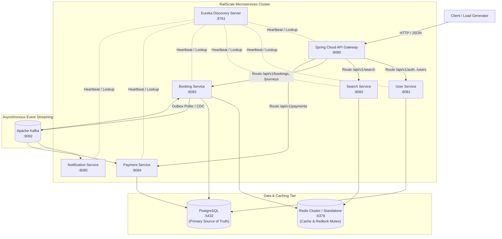

# RailScale — Distributed Railway Seat Booking System
## System Architecture & Topology Specification

---

## 1. Executive Summary

**RailScale** is a high-throughput, distributed railway seat reservation platform engineered to handle extreme booking contention (such as tatkal quota openings) without overselling, deadlocks, or state corruption. 

The system employs a multi-tiered architecture combining:
- **Spring Boot microservices** with Spring Cloud Netflix Eureka for service discovery.
- **Spring Cloud Gateway** as the single unified ingress point for routing, authentication, and rate limiting.
- **Redis** as a distributed caching layer (read path) and short-lived distributed mutex (pre-lock contention reduction).
- **PostgreSQL** as the immutable source of truth, enforcing row-level pessimistic write locking with canonical ID ordering.
- **Apache Kafka** with the **Transactional Outbox Pattern** to guarantee at-least-once asynchronous event delivery without distributed 2PC transactions.
- **Resilience4j** for circuit breaking, bounded retries, and timeouts on inter-service communications.
- **OpenTelemetry & Prometheus** for distributed tracing and end-to-end metrics observability.

---

## 2. Microservice Topology



---

## 3. Service Responsibilities

### 3.1 Spring Cloud API Gateway (Port 8080)
- Unified ingress point for external traffic.
- JWT validation and user identity propagation downstream via HTTP headers (`X-User-Id`, `X-User-Role`).
- IP and user-based token bucket rate limiting using Redis.
- Circuit breaker integration via Resilience4j to fail fast when downstream services become unresponsive.

### 3.2 User Service (Port 8081)
- User registration, authentication, password hashing (BCrypt), and JWT issuance.
- Profile and role management (`ROLE_USER`, `ROLE_ADMIN`).
- Backed by PostgreSQL `users` table.

### 3.3 Search Service (Port 8082)
- High-performance, read-heavy catalog search for trains, stations, routes, and live seat availability.
- Multi-layer caching: Local in-memory cache and Redis cache with short TTL (e.g., 5 seconds) to absorb massive search spikes.
- Employs cache stampede prevention (mutex / probabilistic early expiration).

### 3.4 Booking Service (Port 8083) — Core Engine
- Manages the lifecycle of seat reservations: `AVAILABLE` -> `HELD` -> `PAYMENT_PENDING` -> `CONFIRMED` / `FAILED` / `EXPIRED`.
- Dual-layer concurrency control:
  1. **Redis distributed lock** for fast-fail pre-locking.
  2. **PostgreSQL row-level write locks** (`SELECT ... FOR UPDATE`) sorted canonically by seat inventory UUID.
- Scheduled hold expiration and payment timeout reconciliation (`ReservationReconciliationService`).
- Transactional Outbox publisher for reliable event publishing.

### 3.5 Payment Service (Port 8084)
- Payment initiation, webhook ingestion from mock/real payment gateways.
- Publishes `PaymentCompleted` and `PaymentFailed` events to Kafka.
- Handles automated refunds on late payments or booking failures.

### 3.6 Notification Service (Port 8085)
- Consumes Kafka events (`BookingConfirmed`, `BookingExpired`, `PaymentFailed`, `RefundRequired`).
- Dispatches transactional email/SMS notifications (mocked in development/test).
- Implements idempotent event consumption using a `processed_events` log.

### 3.7 Eureka Server (Port 8761)
- Dynamic registration and discovery for all microservice instances.
- 30-second heartbeat eviction threshold with self-preservation mode in production.

---

## 4. End-to-End Booking Data Flow

```mermaid
sequenceDiagram
    autonumber
    actor User as User Browser / Client
    participant GW as API Gateway
    participant BS as Booking Service
    participant R as Redis
    participant DB as PostgreSQL
    participant K as Kafka
    participant PS as Payment Service

    User->>GW: POST /api/v1/bookings/hold (journeyId, seatIds)
    GW->>BS: Forward with X-User-Id
    BS->>R: Acquire distributed lock on seat keys
    BS->>DB: BEGIN TX; SELECT ... FOR UPDATE (sorted inventory IDs)
    BS->>DB: Validate status == AVAILABLE and held_until expired
    BS->>DB: UPDATE seat_inventory SET status='HELD', held_by=userId, held_until=now+10m
    BS->>DB: INSERT INTO bookings (status='HELD'); INSERT INTO booking_items
    BS->>DB: INSERT INTO outbox_events (SeatHeld)
    BS->>DB: COMMIT TX
    BS->>R: Release distributed lock
    BS-->>User: 201 Created (bookingId, heldUntil)

    User->>GW: POST /api/v1/bookings/{id}/confirm
    GW->>BS: Forward with X-User-Id
    BS->>DB: BEGIN TX; SELECT booking & seats FOR UPDATE
    BS->>DB: Validate hold not expired, update booking status='PAYMENT_PENDING'
    BS->>DB: Extend held_until to now+2m (payment window)
    BS->>DB: INSERT INTO payments (status='PENDING')
    BS->>DB: INSERT INTO outbox_events (PaymentInitiated)
    BS->>DB: COMMIT TX
    BS-->>User: 200 OK (bookingId, paymentDeadline)

    User->>GW: POST /api/v1/payments/{id}/simulate (SUCCESS)
    GW->>PS: Forward Payment
    PS->>K: Publish PaymentCompleted event
    K->>BS: PaymentEventConsumer consumes PaymentCompleted
    BS->>DB: BEGIN TX; Deduplicate via processed_events
    BS->>DB: UPDATE seat_inventory SET status='BOOKED', held_by=NULL, held_until=NULL
    BS->>DB: UPDATE bookings SET status='CONFIRMED'
    BS->>DB: INSERT INTO outbox_events (BookingConfirmed)
    BS->>DB: COMMIT TX
    BS->>K: ACK message
```

---

## 5. Architectural Non-Negotiables (Invariants)

1. **Zero Overselling:** Under no circumstance may two distinct users hold or confirm the same seat inventory for overlapping journey segments.
2. **Canonical Lock Ordering:** All multiple-seat locks must be acquired in strictly ascending order of UUIDs to prevent circular wait deadlocks.
3. **No Dual-Writes:** State changes and event emissions must share a single database transaction via the Transactional Outbox pattern.
4. **Graceful Degradation:** If Redis fails, the system continues serving bookings safely using PostgreSQL row locks.
5. **No Phantom Confirmations:** A late payment arriving after hold expiration never resurrects an expired booking. It triggers an automated refund.
