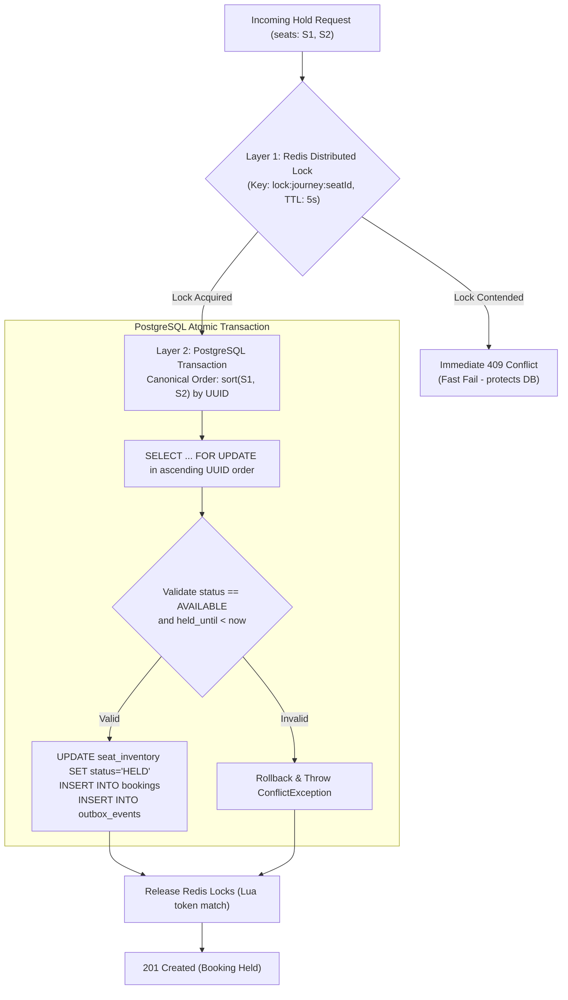

# RailScale — Concurrency Control & Deadlock Prevention
## Dual-Layer Locking Architecture for Extreme Contention

---

## 1. The High-Contention Concurrency Challenge

When popular train routes open for booking (such as Tatkal quotas), hundreds or thousands of concurrent requests attempt to reserve the exact same finite set of seats simultaneously within a sub-second window.

Uncontrolled concurrent access introduces three fatal failure modes:
1. **Overselling (Race Condition):** Two concurrent transactions read a seat as available and both issue `UPDATE seat_inventory SET status='BOOKED'`.
2. **Circular Wait Deadlocks:** User A requests seats `[Seat 1, Seat 2]` while User B concurrently requests `[Seat 2, Seat 1]`. If locks are acquired in arbitrary order, Transaction A locks Seat 1 and waits for Seat 2, while Transaction B locks Seat 2 and waits for Seat 1.
3. **Database Connection Starvation:** Thousands of transactions queue up waiting for row locks, exhausting the connection pool and crashing the database.

---

## 2. The Dual-Layer Concurrency Model

RailScale employs a complementary two-layer concurrency strategy:



### Layer 1: Redis Distributed Pre-Locking
- **Purpose:** Fast-path contention shedder. Rejects surplus requests at memory speed before they hit PostgreSQL connection pools.
- **Implementation:** `SET key token NX PX 5000` via `RedisLockService`.
- **Token Safety:** Uses a random UUID token per request. Lock release executes a Lua script validating token ownership to avoid releasing another transaction's expired lock:
```lua
if redis.call("get", KEYS[1]) == ARGV[1] then
    return redis.call("del", KEYS[1])
else
    return 0
end
```
- **Resilience:** If Redis is down, the system gracefully bypasses Layer 1 and relies on Layer 2.

### Layer 2: PostgreSQL Row-Level Pessimistic Locking
- **Purpose:** Absolute source of truth and ACID consistency guarantee.
- **SQL Execution:**
```sql
SELECT * FROM seat_inventory 
WHERE journey_id = :journeyId AND id IN (:seatIds)
ORDER BY id ASC
FOR UPDATE;
```

---

## 3. Mathematical Elimination of Deadlocks

Under Coffman's conditions for deadlock, four conditions must hold simultaneously:
1. Mutual Exclusion
2. Hold and Wait
3. No Preemption
4. **Circular Wait**

RailScale mathematically eliminates the **Circular Wait** condition:

### Canonical Ordering Rule
Before executing any database lock query, the list of target seat IDs is **strictly sorted in ascending alphanumeric order** by UUID:

$$\text{Lock Order: } \text{UUID}_1 < \text{UUID}_2 < \dots < \text{UUID}_n$$

### Scenario Comparison:
- **Without Canonical Ordering:**
  - Client A requests `[S2, S1]` $\rightarrow$ locks $S_2$, attempts to lock $S_1$.
  - Client B requests `[S1, S2]` $\rightarrow$ locks $S_1$, attempts to lock $S_2$.
  - **Result:** Deadlock exception (`PSQLException: deadlock detected`).

- **With RailScale Canonical Ordering:**
  - Client A requests `[S2, S1]` $\rightarrow$ normalized to `[S1, S2]` $\rightarrow$ attempts to lock $S_1$ first.
  - Client B requests `[S1, S2]` $\rightarrow$ normalized to `[S1, S2]` $\rightarrow$ attempts to lock $S_1$ first.
  - **Result:** Client A acquires lock on $S_1$. Client B queues behind $S_1$. Once Client A completes, Client B acquires $S_1$, sees `status = HELD`, and returns a clean `409 Conflict`. Zero deadlocks occur.

---

## 4. Lease Management & Hold Expiration

Seat holds are leases protected by time-to-live boundaries:
1. **Hold Phase TTL (10 minutes):**
   - When held, `held_until` is set to $\text{now} + 10\text{m}$.
   - If the user abandons before confirmation, any subsequent transaction after 10 minutes treats the hold as expired without manual intervention:
     $$\text{held\_until} < \text{now} \implies \text{Eligible for reallocation}$$
2. **Payment Phase Lease (2 minutes):**
   - Calling `/confirm` validates the 10-minute hold and extends `held_until` to $\text{now} + 2\text{m}$ (payment processing window).
   - If the payment is not completed within 2 minutes, `ReservationReconciliationService` atomically marks the booking `EXPIRED` and frees the seats.
