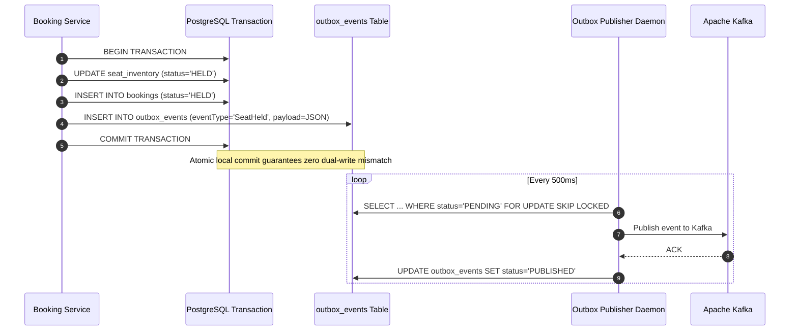

# RailScale — Data Consistency Model
## Boundaries, Guarantees & Dual-Write Mitigation

---

## 1. Consistency Boundary Overview

In a distributed reservation platform, treating the entire system as either purely ACID or purely eventually consistent leads to either crippling latency or catastrophic overselling. RailScale adopts a **hybrid consistency architecture** with strict boundaries:

| Subsystem / Operation | Consistency Model | Mechanism | Rationale |
|---|---|---|---|
| **Seat Inventory Allocation** | **Strict Strong Consistency (ACID)** | PostgreSQL `SELECT ... FOR UPDATE` | Zero overselling invariant cannot tolerate eventual consistency |
| **Booking State Transitions** | **Strict Strong Consistency (ACID)** | PostgreSQL single-transaction commit | Ensures booking, booking items, and hold times transition atomically |
| **Domain Event Propagation** | **Guaranteed At-Least-Once / Eventual** | Transactional Outbox + Kafka | Eliminates distributed 2PC bottlenecks |
| **Search Catalog & Live Availability** | **Bounded Staleness (Eventual)** | Redis Cache (TTL 5s) + Write-through Invalidation | Reads scale to 100k+ QPS; stale reads fail fast on hold phase |
| **Downstream Notifications & Analytics** | **Eventual Consistency** | Kafka Consumers with Idempotency Gate | Notifications do not block client checkout transactions |

---

## 2. Preventing Dual-Write Corruption

### The Distributed Dual-Write Problem
In microservices, executing a database write followed immediately by a Kafka publish call (`db.save(); kafkaTemplate.send();`) creates an unavoidable failure mode:
1. If the database commits but the Kafka publish fails (or process crashes), Kafka never learns about the booking.
2. If Kafka is published first but the database rollback occurs, downstream services process phantom bookings.

### The Solution: Transactional Outbox Pattern
RailScale enforces a single atomic database transaction for every business operation:

---

## 3. Read Consistency & Cache Invalidation

### Cache-Aside with Event-Driven Invalidation
The Search Service and catalog reads query Redis before hitting PostgreSQL:
1. **Cache Miss:** Reads from PostgreSQL, populates Redis with a 5-second TTL.
2. **State Mutated (Hold / Confirm / Expire):**
   - The mutating transaction commits in PostgreSQL.
   - Upon successful transaction commit, `SeatCacheService.invalidateJourneyCache(journeyId)` evicts the journey seat map from Redis immediately.
   - If Redis eviction fails, the tight 5-second TTL bounds staleness to at most 5 seconds.

### Fast-Fail Optimistic Seat Selection
If a client views a slightly stale seat map (showing seat 1A as available while another user held it 100ms ago), the booking engine's pessimistic row lock transaction checks `status == AVAILABLE`. The second user instantly receives a clean `409 Conflict (SEAT_UNAVAILABLE)`, completely preserving inventory invariants.

---

## 4. Consumer Idempotency & Deduplication

Kafka guarantees **at-least-once** delivery. Network reconnects or broker leader rebalances can cause consumers to receive the same event multiple times.

Every consumer (e.g., `PaymentEventConsumer`, `NotificationEventConsumer`) implements the **Idempotent Consumer Gate**:
1. Every event includes a unique `eventId` (UUID) in the `EventEnvelope`.
2. Before processing, the consumer checks `processed_events (consumer_group, event_id)`.
3. The business logic execution and the `processed_events` insert occur within the same local transaction.
4. If a duplicate event arrives, the unique constraint or `existsById` check detects the replay, skips duplicate work, and immediately ACKs the message.

---

## 5. Late Payment Consistency (Critical Invariant 9)

A common distributed edge case occurs when:
1. User holds a seat (10-minute lease).
2. The user initiates payment, but the payment gateway takes 3 minutes instead of the 2-minute deadline.
3. The background `ReservationReconciliationService` expires the booking at minute 2 and releases the seat to `AVAILABLE`.
4. Another passenger immediately books and confirms that seat.
5. Minute 3: The bank webhook arrives with `PaymentCompleted (SUCCESS)`.

### Resolution Guarantee
- **Rule:** An `EXPIRED` booking **must never be resurrected** to `CONFIRMED`.
- The system leaves the booking status as `EXPIRED`.
- The newly released seat remains in its current state (available or reserved by the new passenger).
- The payment entity transitions to `REFUND_PENDING`.
- An outbox event `RefundRequired (reason: PAYMENT_ARRIVED_AFTER_EXPIRY)` is emitted atomically to issue an immediate automated full refund to the original user.
