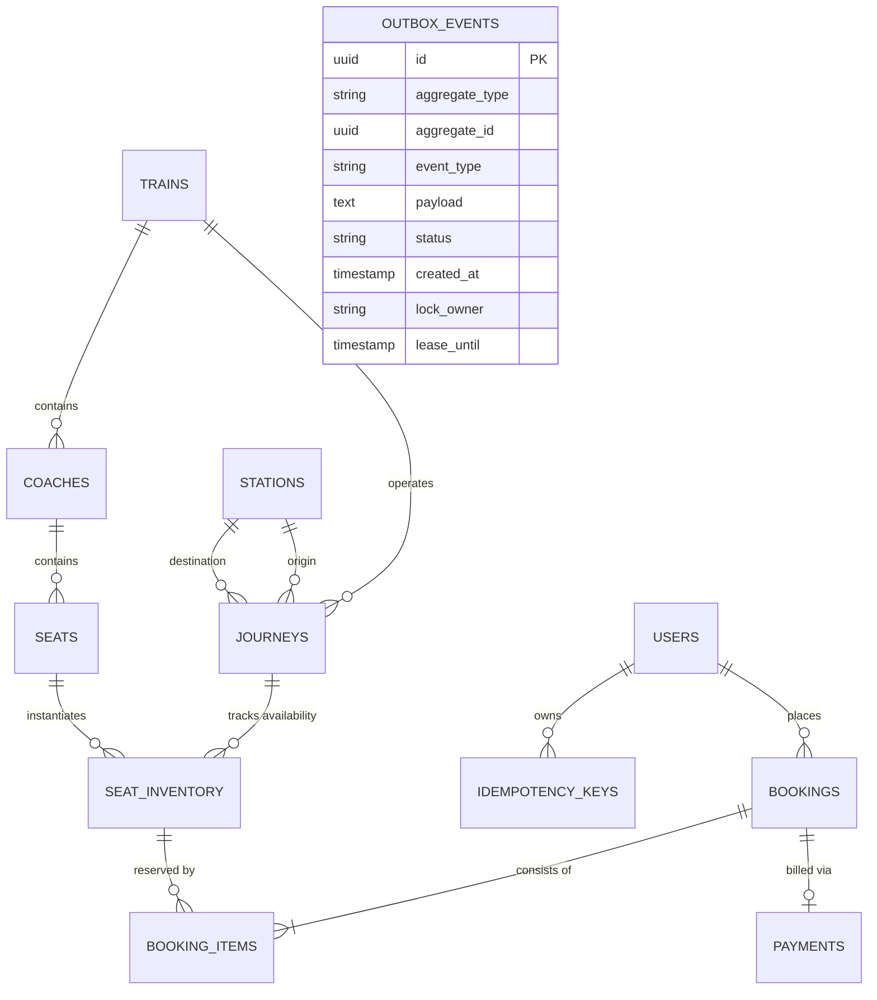

# RailScale — Database Design & Schema Architecture
## Relational Data Modeling for High-Contention Booking

---

## 1. Overview & Core Tenets

The database tier is built on **PostgreSQL 16+**, serving as the single immutable source of truth. The schema is normalized (3NF) to guarantee transactional integrity (ACID), prevent write anomalies, and allow high-concurrency pessimistic row-level locking.

Key schema tenets:
1. **UUID Primary Keys:** All entity primary keys use UUIDs (`v4` or random) to prevent enumeration attacks and eliminate central ID generation contention.
2. **Deterministic Locking Support:** `seat_inventory` rows are accessed and locked via canonical sorted UUID order.
3. **Audit & Metadata Timestamps:** Entities track `created_at`, `updated_at`, and `version` (optimistic locking counter).
4. **Idempotency & Deduplication Storage:** Dedicated tables (`idempotency_keys`, `processed_events`) guarantee zero duplicate requests or duplicate consumer processing.
5. **Transactional Outbox Table:** `outbox_events` guarantees zero dual-write vulnerabilities between PostgreSQL and Kafka.

---

## 2. Entity-Relationship Diagram (ERD)



---

## 3. Core Tables Specification

### 3.1 `seat_inventory` (The Contention Hotspot)
Represents the dynamic status of a physical seat on a specific journey leg.

```sql
CREATE TABLE seat_inventory (
    id UUID PRIMARY KEY,
    journey_id UUID NOT NULL REFERENCES journeys(id) ON DELETE CASCADE,
    seat_id UUID NOT NULL REFERENCES seats(id) ON DELETE CASCADE,
    status VARCHAR(20) NOT NULL DEFAULT 'AVAILABLE', -- AVAILABLE, HELD, BOOKED
    held_by UUID REFERENCES users(id),
    held_until TIMESTAMP WITH TIME ZONE,
    price NUMERIC(10, 2) NOT NULL,
    version BIGINT NOT NULL DEFAULT 0,
    created_at TIMESTAMP WITH TIME ZONE NOT NULL,
    updated_at TIMESTAMP WITH TIME ZONE NOT NULL,
    CONSTRAINT uk_journey_seat UNIQUE (journey_id, seat_id),
    CONSTRAINT chk_hold_consistency CHECK (
        (status = 'HELD' AND held_by IS NOT NULL AND held_until IS NOT NULL) OR
        (status != 'HELD' AND held_by IS NULL AND held_until IS NULL)
    )
);
```

### 3.2 `bookings`
Tracks user reservation lifecycle.

```sql
CREATE TABLE bookings (
    id UUID PRIMARY KEY,
    user_id UUID NOT NULL REFERENCES users(id),
    journey_id UUID NOT NULL REFERENCES journeys(id),
    status VARCHAR(20) NOT NULL, -- HELD, PAYMENT_PENDING, CONFIRMED, CANCELLED, EXPIRED, FAILED
    total_amount NUMERIC(10, 2) NOT NULL,
    payment_initiated_at TIMESTAMP WITH TIME ZONE,
    created_at TIMESTAMP WITH TIME ZONE NOT NULL,
    updated_at TIMESTAMP WITH TIME ZONE NOT NULL,
    version BIGINT NOT NULL DEFAULT 0
);
```

### 3.3 `booking_items`
Maps multiple seats reserved within a single booking.

```sql
CREATE TABLE booking_items (
    id UUID PRIMARY KEY,
    booking_id UUID NOT NULL REFERENCES bookings(id) ON DELETE CASCADE,
    inventory_id UUID NOT NULL REFERENCES seat_inventory(id),
    price NUMERIC(10, 2) NOT NULL,
    CONSTRAINT uk_booking_inventory UNIQUE (booking_id, inventory_id)
);
```

### 3.4 `outbox_events` (Transactional Messaging)
Enables reliable event-driven propagation to Kafka.

```sql
CREATE TABLE outbox_events (
    id UUID PRIMARY KEY,
    aggregate_type VARCHAR(50) NOT NULL,
    aggregate_id UUID NOT NULL,
    event_type VARCHAR(100) NOT NULL,
    payload JSONB NOT NULL,
    status VARCHAR(20) NOT NULL DEFAULT 'PENDING', -- PENDING, PUBLISHED, FAILED
    created_at TIMESTAMP WITH TIME ZONE NOT NULL,
    published_at TIMESTAMP WITH TIME ZONE,
    retry_count INT NOT NULL DEFAULT 0,
    lock_owner VARCHAR(100),
    lease_until TIMESTAMP WITH TIME ZONE
);
```

### 3.5 `idempotency_keys` (API Gateway / Client Protection)
Stores request tokens and cached responses to prevent duplicate operations.

```sql
CREATE TABLE idempotency_keys (
    id UUID PRIMARY KEY,
    user_id UUID NOT NULL REFERENCES users(id) ON DELETE CASCADE,
    key_value VARCHAR(255) NOT NULL,
    request_hash VARCHAR(64) NOT NULL,
    response_body TEXT,
    response_code INT,
    status VARCHAR(20) NOT NULL, -- IN_PROGRESS, COMPLETED, FAILED
    created_at TIMESTAMP WITH TIME ZONE NOT NULL,
    expires_at TIMESTAMP WITH TIME ZONE NOT NULL,
    CONSTRAINT uk_user_idempotency UNIQUE (user_id, key_value)
);
```

### 3.6 `processed_events` (Consumer Deduplication)
Ensures at-least-once Kafka messages are processed exactly once.

```sql
CREATE TABLE processed_events (
    consumer_group VARCHAR(100) NOT NULL,
    event_id UUID NOT NULL,
    processed_at TIMESTAMP WITH TIME ZONE NOT NULL,
    PRIMARY KEY (consumer_group, event_id)
);
```

---

## 4. Indexing & Concurrency Optimization Strategy

1. **Deterministic Lock Traversal Index:**
   `CREATE INDEX idx_seat_inventory_journey_id ON seat_inventory (journey_id, id);`
   Ensures `SELECT ... FOR UPDATE WHERE journey_id = ? AND seat_id IN (...)` uses an efficient index scan and locks rows with minimal btree overhead.

2. **Reconciliation Sweeper Indexes:**
   - `CREATE INDEX idx_seat_inventory_held ON seat_inventory (status, held_until) WHERE status = 'HELD';`
   - `CREATE INDEX idx_bookings_pending_payment ON bookings (status, payment_initiated_at) WHERE status = 'PAYMENT_PENDING';`
   Enables sub-millisecond index scans for the background reconciliation scheduler without scanning non-expired or active records.

3. **Outbox Polling Index:**
   `CREATE INDEX idx_outbox_pending ON outbox_events (status, created_at ASC) WHERE status = 'PENDING';`
   Provides rapid batch fetching for the outbox publisher daemon.
