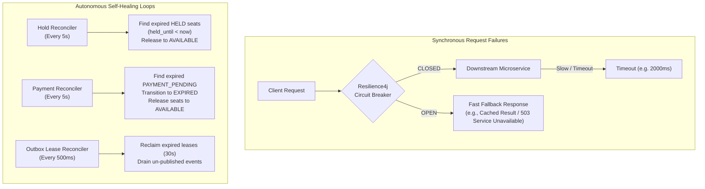

# RailScale — Failure Recovery & System Resilience
## Self-Healing Mechanics, Circuit Breakers & Reconciliation

---

## 1. Resilience Architecture Overview

RailScale is built to tolerate infrastructure failures (crashed instances, network partitions, degraded databases) without manual intervention or data corruption.



---

## 2. Circuit Breakers, Timeouts & Bounded Retries

Configured via **Resilience4j** across all Feign/WebClient calls and API Gateway routes:

### Configuration Parameters
- **Sliding Window:** 50 calls (count-based).
- **Failure Rate Threshold:** 50% (transitions `CLOSED` $\rightarrow$ `OPEN`).
- **Slow Call Rate Threshold:** 50% with slow call duration $> 2000\text{ms}$.
- **Wait Duration in Open State:** 10 seconds before transitioning to `HALF_OPEN`.
- **Permitted Number of Calls in Half-Open State:** 10 calls.
- **Bounded Retries:** Maximum 3 attempts with exponential backoff ($200\text{ms}, 400\text{ms}, 800\text{ms}$), applied only to idempotent read operations. Never retry non-idempotent booking mutations automatically at the transport layer without an idempotency key.

---

## 3. Autonomous Reconciliation Engines

### 3.1 Seat Hold Expiration
- **Trigger:** Scheduled every 5,000ms via `ReservationReconciliationService.expireHolds()`.
- **Query:**
```sql
SELECT s FROM SeatInventory s 
WHERE s.status = 'HELD' AND s.heldUntil < :now 
ORDER BY s.id ASC 
FOR UPDATE;
```
- **Action:** Atomically resets `status = AVAILABLE`, `heldBy = null`, `heldUntil = null`, increments `version`, and marks any associated `HELD` booking as `EXPIRED`. Emits `SeatReleased` outbox event.

### 3.2 Payment Pending Expiration
- **Trigger:** Scheduled every 5,000ms via `ReservationReconciliationService.expirePaymentPendingBookings()`.
- **Query:**
```sql
SELECT b FROM Booking b 
WHERE b.status = 'PAYMENT_PENDING' AND b.paymentInitiatedAt < :cutoff 
ORDER BY b.id ASC 
FOR UPDATE;
```
- **Action:** Atomically transitions booking to `EXPIRED`, frees all associated seat inventories back to `AVAILABLE`, and emits `BookingExpired` and `SeatReleased` outbox events.

---

## 4. Leaderless Outbox Lease Reclaim

Rather than relying on a fragile single-leader election (which introduces a single point of failure), outbox event publishing uses a **distributed lease mechanism directly in PostgreSQL**:
1. When a worker instance polls for outbox events, it claims a batch by setting:
   `UPDATE outbox_events SET lock_owner = :workerId, lease_until = :now + 30s WHERE ...`
2. If the worker JVM crashes or is killed by Kubernetes/Docker, its uncommitted batch remains locked for at most 30 seconds.
3. Once 30 seconds elapse, any surviving peer worker instance detects `lease_until < now`, claims the batch, and publishes it to Kafka.
4. Guaranteed zero message loss and automatic recovery without human intervention.

---

## 5. Critical Edge Case: Late Payment Refund Pattern

If a user's payment completes after the 2-minute payment window has expired:
1. The booking has already been transitioned to `EXPIRED` and seats released.
2. The payment callback arrives with `PaymentStatus.SUCCESS`.
3. `BookingService.processPaymentResult` detects that the booking is in `EXPIRED` status.
4. **Resolution:**
   - The booking **remains `EXPIRED`**.
   - The payment entity status is set to `REFUND_PENDING`.
   - A `RefundRequired` outbox event is emitted containing the booking ID, refund amount, and reason `PAYMENT_ARRIVED_AFTER_EXPIRY`.
   - The payment gateway processes an automated refund to the customer's original payment method.
